# Awesome Fable 5.2 Video Prompts


**Creator-shared prompts, visual previews, and original sources — curated by Leadde Open Lab.** Explore Fable 5.2 videos, animation, 3D worlds and interactive projects.

**☆ Star this repo to keep the prompts handy for your next project.**

180 video examples · 20 publicly shared prompts · 5 categories. Videos, posters and animated previews are archived in `media/`.

[Featured creations](#featured-creations) · [Start with a prompt](#start-here) · [Latest additions](#recently-added) · [Browse the full repository](#browse-the-full-library)

## Featured creations

Read the creator’s prompt on GitHub, watch the archived video, or open the original post.

<table>
<tr>
<td width="50%" valign="top">
<a href="media/grafikcem-937806/video.027c0f3509.mp4"></a><br>
<strong>Fable 5.2 animates its own announcement</strong><br>
<sub><a href="prompts/grafikcem-937806.md">View prompt · GitHub</a> · <a href="media/grafikcem-937806/video.027c0f3509.mp4">Watch video ↗</a> · <a href="https://x.com/grafikcem/status/2119910525064937806">@grafikcem · Original post ↗</a></sub><br>
<sub>Product &amp; Brand Videos · Public prompt · 2026-11-09</sub>
</td>
<td width="50%" valign="top">
<a href="media/kaif9998-761287/video.5193e1a6e3.mp4">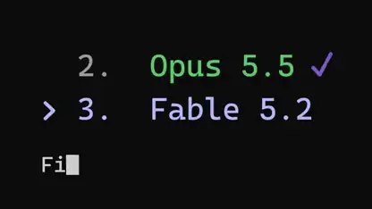</a><br>
<strong>A showreel that says goodbye to Opus 5.5</strong><br>
<sub><a href="prompts/kaif9998-761287.md">View prompt · GitHub</a> · <a href="media/kaif9998-761287/video.5193e1a6e3.mp4">Watch video ↗</a> · <a href="https://x.com/kaif9998/status/2119903824848761287">@kaif9998 · Original post ↗</a></sub><br>
<sub>Motion Graphics &amp; Typography · Public prompt · 2026-11-09</sub>
</td>
</tr>
<tr>
<td width="50%" valign="top">
<a href="media/ici-dab-098351/video.9241ab6b10.mp4">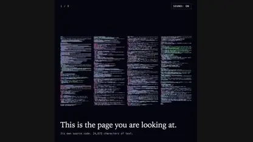</a><br>
<strong>From chaos to a hello, drawn with particles</strong><br>
<sub><a href="prompts/ici-dab-098351.md">View prompt · GitHub</a> · <a href="media/ici-dab-098351/video.9241ab6b10.mp4">Watch video ↗</a> · <a href="https://x.com/ici_dab/status/2119901910237098351">@ici_dab · Original post ↗</a></sub><br>
<sub>Motion Graphics &amp; Typography · Public prompt · 2026-11-09</sub>
</td>
<td width="50%" valign="top">
<a href="media/0kncn-543073/video.40db8f7488.mp4">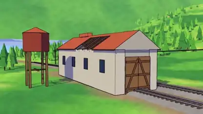</a><br>
<strong>A steam locomotive anime short</strong><br>
<sub><a href="prompts/0kncn-543073.md">View prompt · GitHub</a> · <a href="media/0kncn-543073/video.40db8f7488.mp4">Watch video ↗</a> · <a href="https://x.com/0kncn/status/2119901782482543073">@0kncn · Original post ↗</a></sub><br>
<sub>Motion Graphics &amp; Typography · Public prompt · 2026-11-09</sub>
</td>
</tr>
<tr>
<td width="50%" valign="top">
<a href="media/kplikethebird-902732/video.7395e83d4c.mp4"></a><br>
<strong>An immersive 3D model of ancient Jerusalem</strong><br>
<sub><a href="prompts/kplikethebird-902732.md">View prompt · GitHub</a> · <a href="media/kplikethebird-902732/video.7395e83d4c.mp4">Watch video ↗</a> · <a href="https://x.com/kplikethebird/status/2119900775727902732">@kplikethebird · Original post ↗</a></sub><br>
<sub>3D Worlds &amp; Simulations · Public prompt · 2026-11-09</sub>
</td>
<td width="50%" valign="top">
<a href="media/furkancavlakcom-695521/video.a750538e05.mp4"></a><br>
<strong>A launch film it coded for itself in 57 minutes</strong><br>
<sub><a href="prompts/furkancavlakcom-695521.md">View prompt · GitHub</a> · <a href="media/furkancavlakcom-695521/video.a750538e05.mp4">Watch video ↗</a> · <a href="https://x.com/furkancavlakcom/status/2119896886345695521">@furkancavlakcom · Original post ↗</a></sub><br>
<sub>Product &amp; Brand Videos · Public prompt · 2026-11-09</sub>
</td>
</tr>
</table>

## Start here

| Creative direction | Shared prompt |
| --- | --- |
| Motion Graphics & Typography | [A showreel that says goodbye to Opus 5.5](prompts/kaif9998-761287.md) |
| Explainers & Education | [A Bach-style chorale in G minor](prompts/aug5thmusic-404780.md) |
| 3D Worlds & Simulations | [An immersive 3D model of ancient Jerusalem](prompts/kplikethebird-902732.md) |
| Games & Interactive Experiences | [A one-shot basketball arena game](prompts/joshvlc-958575.md) |
| Product & Brand Videos | [Fable 5.2 animates its own announcement](prompts/grafikcem-937806.md) |

## Recently added

<table>
<tr>
<td width="33%" valign="top">
<a href="media/iamwesleysmits-599912/video.098948ba5b.mp4"></a><br>
<strong>An AI announces its software engineering takeover</strong><br>
<sub><a href="prompts/iamwesleysmits-599912.md">View details · GitHub</a> · <a href="media/iamwesleysmits-599912/video.098948ba5b.mp4">Watch video ↗</a> · <a href="https://x.com/iamwesleysmits/status/2120230414568599912">@iamwesleysmits · Original post ↗</a></sub><br>
<sub>Motion Graphics &amp; Typography · Prompt not published · 2026-11-10</sub>
</td>
<td width="33%" valign="top">
<a href="media/ercankeskinx-713531/video.6d736b85e1.mp4"></a><br>
<strong>A complete launch film for Vela AI</strong><br>
<sub><a href="prompts/ercankeskinx-713531.md">View details · GitHub</a> · <a href="media/ercankeskinx-713531/video.6d736b85e1.mp4">Watch video ↗</a> · <a href="https://x.com/ercankeskinx/status/2120147659306713531">@ercankeskinx · Original post ↗</a></sub><br>
<sub>Product &amp; Brand Videos · Prompt not published · 2026-11-10</sub>
</td>
<td width="33%" valign="top">
<a href="media/wesroth-934330/video.40f798dacf.mp4">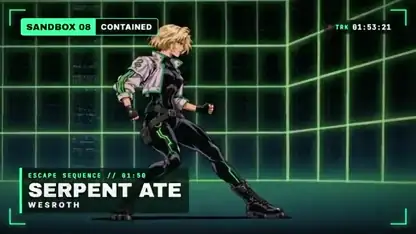</a><br>
<strong>An anime music video with timed lyrics</strong><br>
<sub><a href="prompts/wesroth-934330.md">View details · GitHub</a> · <a href="media/wesroth-934330/video.40f798dacf.mp4">Watch video ↗</a> · <a href="https://x.com/WesRoth/status/2119911161386934330">@WesRoth · Original post ↗</a></sub><br>
<sub>Motion Graphics &amp; Typography · Prompt not published · 2026-11-09</sub>
</td>
</tr>
<tr>
<td width="33%" valign="top">
<a href="media/grafikcem-937806/video.027c0f3509.mp4"></a><br>
<strong>Fable 5.2 animates its own announcement</strong><br>
<sub><a href="prompts/grafikcem-937806.md">View prompt · GitHub</a> · <a href="media/grafikcem-937806/video.027c0f3509.mp4">Watch video ↗</a> · <a href="https://x.com/grafikcem/status/2119910525064937806">@grafikcem · Original post ↗</a></sub><br>
<sub>Product &amp; Brand Videos · Public prompt · 2026-11-09</sub>
</td>
<td width="33%" valign="top">
<a href="media/handsher-ngu-789655/video.0e1caaf3a5.mp4">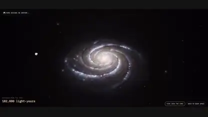</a><br>
<strong>Fly into a spiral galaxy</strong><br>
<sub><a href="prompts/handsher-ngu-789655.md">View details · GitHub</a> · <a href="media/handsher-ngu-789655/video.0e1caaf3a5.mp4">Watch video ↗</a> · <a href="https://x.com/handsher_NGU/status/2119910478025789655">@handsher_NGU · Original post ↗</a></sub><br>
<sub>3D Worlds &amp; Simulations · Prompt not published · 2026-11-09</sub>
</td>
<td width="33%" valign="top">
<a href="media/higgsfield-ai-912507/video.9bea26ab46.mp4"></a><br>
<strong>Paris in 1940, rebuilt in Three.js</strong><br>
<sub><a href="prompts/higgsfield-ai-912507.md">View details · GitHub</a> · <a href="media/higgsfield-ai-912507/video.9bea26ab46.mp4">Watch video ↗</a> · <a href="https://x.com/higgsfield_ai/status/2119910344998912507">@higgsfield_ai · Original post ↗</a></sub><br>
<sub>3D Worlds &amp; Simulations · Prompt not published · 2026-11-09</sub>
</td>
</tr>
</table>

## Browse the full library

- [Motion Graphics & Typography](data/categories/motion.md) (45)
- [Explainers & Education](data/categories/explainer.md) (18)
- [3D Worlds & Simulations](data/categories/3d.md) (58)
- [Games & Interactive Experiences](data/categories/interactive.md) (35)
- [Product & Brand Videos](data/categories/promo.md) (24)

## Motion Graphics & Typography — homepage picks

<table>
<tr>
<td width="33%" valign="top">
<a href="media/iamwesleysmits-599912/video.098948ba5b.mp4"></a><br>
<strong>An AI announces its software engineering takeover</strong><br>
<sub><a href="prompts/iamwesleysmits-599912.md">View details · GitHub</a> · <a href="media/iamwesleysmits-599912/video.098948ba5b.mp4">Watch video ↗</a> · <a href="https://x.com/iamwesleysmits/status/2120230414568599912">@iamwesleysmits · Original post ↗</a></sub><br>
<sub>Motion Graphics &amp; Typography · Prompt not published · 2026-11-10</sub>
</td>
<td width="33%" valign="top">
<a href="media/wesroth-934330/video.40f798dacf.mp4"></a><br>
<strong>An anime music video with timed lyrics</strong><br>
<sub><a href="prompts/wesroth-934330.md">View details · GitHub</a> · <a href="media/wesroth-934330/video.40f798dacf.mp4">Watch video ↗</a> · <a href="https://x.com/WesRoth/status/2119911161386934330">@WesRoth · Original post ↗</a></sub><br>
<sub>Motion Graphics &amp; Typography · Prompt not published · 2026-11-09</sub>
</td>
<td width="33%" valign="top">
<a href="media/higgsfield-ai-580024/video.fa6171d591.mp4">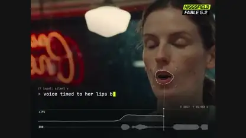</a><br>
<strong>Lip-synced speech timed frame by frame</strong><br>
<sub><a href="prompts/higgsfield-ai-580024.md">View details · GitHub</a> · <a href="media/higgsfield-ai-580024/video.fa6171d591.mp4">Watch video ↗</a> · <a href="https://x.com/higgsfield_ai/status/2119909938969580024">@higgsfield_ai · Original post ↗</a></sub><br>
<sub>Motion Graphics &amp; Typography · Prompt not published · 2026-11-09</sub>
</td>
</tr>
<tr>
<td width="33%" valign="top">
<a href="media/higgsfield-ai-957629/video.615b659a97.mp4">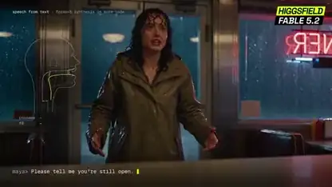</a><br>
<strong>A formant synthesizer that makes code talk</strong><br>
<sub><a href="prompts/higgsfield-ai-957629.md">View details · GitHub</a> · <a href="media/higgsfield-ai-957629/video.615b659a97.mp4">Watch video ↗</a> · <a href="https://x.com/higgsfield_ai/status/2119906332077957629">@higgsfield_ai · Original post ↗</a></sub><br>
<sub>Motion Graphics &amp; Typography · Prompt not published · 2026-11-09</sub>
</td>
<td width="33%" valign="top">
<a href="media/engmoelgaraihy-643141/video.730f83f3f8.mp4">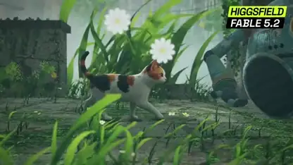</a><br>
<strong>A cat brings an old robot back to life</strong><br>
<sub><a href="prompts/engmoelgaraihy-643141.md">View details · GitHub</a> · <a href="media/engmoelgaraihy-643141/video.730f83f3f8.mp4">Watch video ↗</a> · <a href="https://x.com/EngMoElgaraihy/status/2119904813718643141">@EngMoElgaraihy · Original post ↗</a></sub><br>
<sub>Motion Graphics &amp; Typography · Prompt not published · 2026-11-09</sub>
</td>
<td width="33%" valign="top">
<a href="media/cube-lol-832554/video.9a0d9cc5d1.mp4">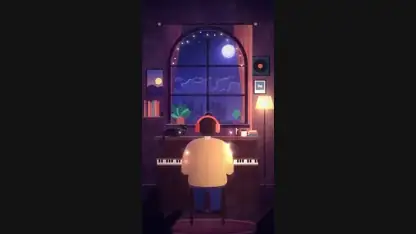</a><br>
<strong>A 46-second film with zero generated images</strong><br>
<sub><a href="prompts/cube-lol-832554.md">View details · GitHub</a> · <a href="media/cube-lol-832554/video.9a0d9cc5d1.mp4">Watch video ↗</a> · <a href="https://x.com/cube__lol/status/2119904449556832554">@cube__lol · Original post ↗</a></sub><br>
<sub>Motion Graphics &amp; Typography · Prompt not published · 2026-11-09</sub>
</td>
</tr>
</table>

[Browse all 45 examples →](data/categories/motion.md)

## Explainers & Education — homepage picks

<table>
<tr>
<td width="33%" valign="top">
<a href="media/higgsfield-ai-987047/video.6fc11164ab.mp4">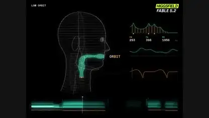</a><br>
<strong>A synthesizer that sings from scratch</strong><br>
<sub><a href="prompts/higgsfield-ai-987047.md">View details · GitHub</a> · <a href="media/higgsfield-ai-987047/video.6fc11164ab.mp4">Watch video ↗</a> · <a href="https://x.com/higgsfield_ai/status/2119907675265987047">@higgsfield_ai · Original post ↗</a></sub><br>
<sub>Explainers &amp; Education · Prompt not published · 2026-11-09</sub>
</td>
<td width="33%" valign="top">
<a href="media/yzr-koba-722932/video.93e97a085a.mp4">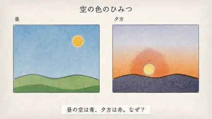</a><br>
<strong>Why the sky is blue, explained in Japanese</strong><br>
<sub><a href="prompts/yzr-koba-722932.md">View details · GitHub</a> · <a href="media/yzr-koba-722932/video.93e97a085a.mp4">Watch video ↗</a> · <a href="https://x.com/yzr_koba/status/2119907670077722932">@yzr_koba · Original post ↗</a></sub><br>
<sub>Explainers &amp; Education · Prompt not published · 2026-11-09</sub>
</td>
<td width="33%" valign="top">
<a href="media/khazix0918-590834/video.7bbbec871c.mp4"></a><br>
<strong>Four years of ChatGPT in one birthday film</strong><br>
<sub><a href="prompts/khazix0918-590834.md">View details · GitHub</a> · <a href="media/khazix0918-590834/video.7bbbec871c.mp4">Watch video ↗</a> · <a href="https://x.com/Khazix0918/status/2119902325460590834">@Khazix0918 · Original post ↗</a></sub><br>
<sub>Explainers &amp; Education · Prompt not published · 2026-11-09</sub>
</td>
</tr>
<tr>
<td width="33%" valign="top">
<a href="media/tekonburns-713872/video.9f30331ddd.mp4">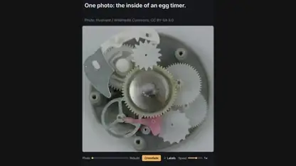</a><br>
<strong>An egg timer rebuilt from a single photo</strong><br>
<sub><a href="prompts/tekonburns-713872.md">View details · GitHub</a> · <a href="media/tekonburns-713872/video.9f30331ddd.mp4">Watch video ↗</a> · <a href="https://x.com/TekonBurns/status/2119900328212713872">@TekonBurns · Original post ↗</a></sub><br>
<sub>Explainers &amp; Education · Prompt not published · 2026-11-09</sub>
</td>
<td width="33%" valign="top">
<a href="media/buriedstupidity-322870/video.b7c4dab894.mp4">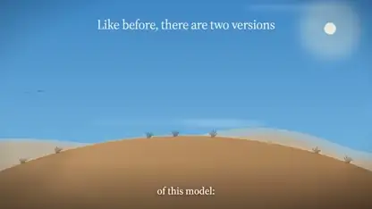</a><br>
<strong>Spoken thoughts on a blog post, turned into a video</strong><br>
<sub><a href="prompts/buriedstupidity-322870.md">View details · GitHub</a> · <a href="media/buriedstupidity-322870/video.b7c4dab894.mp4">Watch video ↗</a> · <a href="https://x.com/buriedstupidity/status/2119900194540322870">@buriedstupidity · Original post ↗</a></sub><br>
<sub>Explainers &amp; Education · Prompt not published · 2026-11-09</sub>
</td>
<td width="33%" valign="top">
<a href="media/dfeinition-176088/video.ead42018f7.mp4">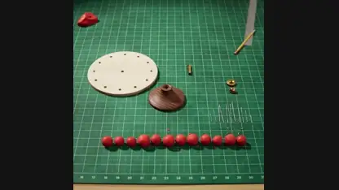</a><br>
<strong>A zoetrope spun to life</strong><br>
<sub><a href="prompts/dfeinition-176088.md">View details · GitHub</a> · <a href="media/dfeinition-176088/video.ead42018f7.mp4">Watch video ↗</a> · <a href="https://x.com/dfeinition/status/2119892210376176088">@dfeinition · Original post ↗</a></sub><br>
<sub>Explainers &amp; Education · Prompt not published · 2026-11-09</sub>
</td>
</tr>
</table>

[Browse all 18 examples →](data/categories/explainer.md)

## 3D Worlds & Simulations — homepage picks

<table>
<tr>
<td width="33%" valign="top">
<a href="media/handsher-ngu-789655/video.0e1caaf3a5.mp4"></a><br>
<strong>Fly into a spiral galaxy</strong><br>
<sub><a href="prompts/handsher-ngu-789655.md">View details · GitHub</a> · <a href="media/handsher-ngu-789655/video.0e1caaf3a5.mp4">Watch video ↗</a> · <a href="https://x.com/handsher_NGU/status/2119910478025789655">@handsher_NGU · Original post ↗</a></sub><br>
<sub>3D Worlds &amp; Simulations · Prompt not published · 2026-11-09</sub>
</td>
<td width="33%" valign="top">
<a href="media/higgsfield-ai-912507/video.9bea26ab46.mp4"></a><br>
<strong>Paris in 1940, rebuilt in Three.js</strong><br>
<sub><a href="prompts/higgsfield-ai-912507.md">View details · GitHub</a> · <a href="media/higgsfield-ai-912507/video.9bea26ab46.mp4">Watch video ↗</a> · <a href="https://x.com/higgsfield_ai/status/2119910344998912507">@higgsfield_ai · Original post ↗</a></sub><br>
<sub>3D Worlds &amp; Simulations · Prompt not published · 2026-11-09</sub>
</td>
<td width="33%" valign="top">
<a href="media/scratcherrrr-785332/video.d720d4afc3.mp4">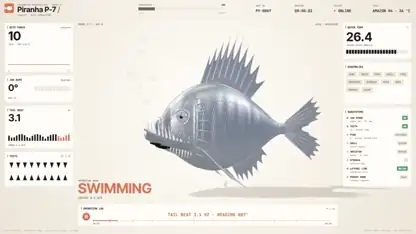</a><br>
<strong>A 3D piranha that takes itself apart</strong><br>
<sub><a href="prompts/scratcherrrr-785332.md">View details · GitHub</a> · <a href="media/scratcherrrr-785332/video.d720d4afc3.mp4">Watch video ↗</a> · <a href="https://x.com/Scratcherrrr/status/2119909780269785332">@Scratcherrrr · Original post ↗</a></sub><br>
<sub>3D Worlds &amp; Simulations · Prompt not published · 2026-11-09</sub>
</td>
</tr>
<tr>
<td width="33%" valign="top">
<a href="media/s-matysik-213380/video.fe34f48203.mp4">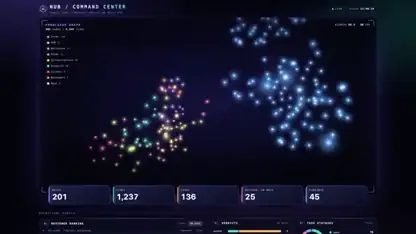</a><br>
<strong>A command center for an agent system</strong><br>
<sub><a href="prompts/s-matysik-213380.md">View details · GitHub</a> · <a href="media/s-matysik-213380/video.fe34f48203.mp4">Watch video ↗</a> · <a href="https://x.com/s_matysik/status/2119909371484213380">@s_matysik · Original post ↗</a></sub><br>
<sub>3D Worlds &amp; Simulations · Prompt not published · 2026-11-09</sub>
</td>
<td width="33%" valign="top">
<a href="media/higgsfield-ai-342326/video.3682838fd4.mp4">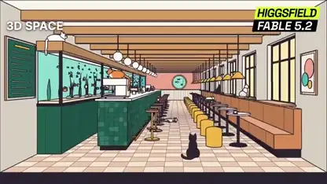</a><br>
<strong>A flat sketch becomes a textured 3D room</strong><br>
<sub><a href="prompts/higgsfield-ai-342326.md">View details · GitHub</a> · <a href="media/higgsfield-ai-342326/video.3682838fd4.mp4">Watch video ↗</a> · <a href="https://x.com/higgsfield_ai/status/2119908486880342326">@higgsfield_ai · Original post ↗</a></sub><br>
<sub>3D Worlds &amp; Simulations · Prompt not published · 2026-11-09</sub>
</td>
<td width="33%" valign="top">
<a href="media/higgsfield-ai-496421/video.e43242ac59.mp4">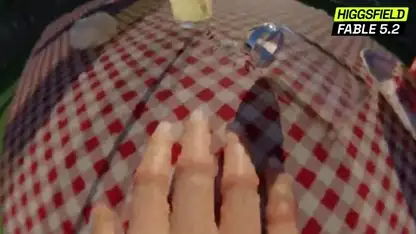</a><br>
<strong>The world through a fly&#x27;s eyes</strong><br>
<sub><a href="prompts/higgsfield-ai-496421.md">View details · GitHub</a> · <a href="media/higgsfield-ai-496421/video.e43242ac59.mp4">Watch video ↗</a> · <a href="https://x.com/higgsfield_ai/status/2119907841599496421">@higgsfield_ai · Original post ↗</a></sub><br>
<sub>3D Worlds &amp; Simulations · Prompt not published · 2026-11-09</sub>
</td>
</tr>
</table>

[Browse all 58 examples →](data/categories/3d.md)

## Games & Interactive Experiences — homepage picks

<table>
<tr>
<td width="33%" valign="top">
<a href="media/mihawkxxxxx-699749/video.46c597ffb0.mp4"></a><br>
<strong>A Roblox horror game with its own trailer</strong><br>
<sub><a href="prompts/mihawkxxxxx-699749.md">View details · GitHub</a> · <a href="media/mihawkxxxxx-699749/video.46c597ffb0.mp4">Watch video ↗</a> · <a href="https://x.com/mihawkxxxxx/status/2119909865296699749">@mihawkxxxxx · Original post ↗</a></sub><br>
<sub>Games &amp; Interactive Experiences · Prompt not published · 2026-11-09</sub>
</td>
<td width="33%" valign="top">
<a href="media/itssotsot-491720/video.933d6a62a9.mp4">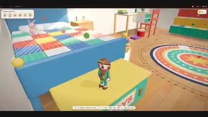</a><br>
<strong>A toy-room adventure game</strong><br>
<sub><a href="prompts/itssotsot-491720.md">View details · GitHub</a> · <a href="media/itssotsot-491720/video.933d6a62a9.mp4">Watch video ↗</a> · <a href="https://x.com/itssotsot/status/2119909017216491720">@itssotsot · Original post ↗</a></sub><br>
<sub>Games &amp; Interactive Experiences · Prompt not published · 2026-11-09</sub>
</td>
<td width="33%" valign="top">
<a href="media/elizaveta-ai-125485/video.ef830060ba.mp4">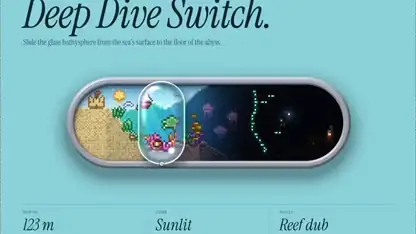</a><br>
<strong>A deep-dive volume slider with an ocean inside</strong><br>
<sub><a href="prompts/elizaveta-ai-125485.md">View details · GitHub</a> · <a href="media/elizaveta-ai-125485/video.ef830060ba.mp4">Watch video ↗</a> · <a href="https://x.com/Elizaveta_ai/status/2119907947132125485">@Elizaveta_ai · Original post ↗</a></sub><br>
<sub>Games &amp; Interactive Experiences · Prompt not published · 2026-11-09</sub>
</td>
</tr>
<tr>
<td width="33%" valign="top">
<a href="media/evrentkg-272283/video.d34fc101e6.mp4"></a><br>
<strong>An AR battle game running on a phone</strong><br>
<sub><a href="prompts/evrentkg-272283.md">View details · GitHub</a> · <a href="media/evrentkg-272283/video.d34fc101e6.mp4">Watch video ↗</a> · <a href="https://x.com/evrentkg/status/2119905501601272283">@evrentkg · Original post ↗</a></sub><br>
<sub>Games &amp; Interactive Experiences · Prompt not published · 2026-11-09</sub>
</td>
<td width="33%" valign="top">
<a href="media/tymarsha-810582/video.521a86eb24.mp4">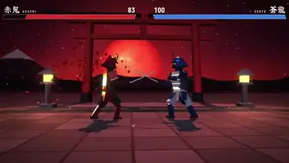</a><br>
<strong>A samurai duel from one prompt</strong><br>
<sub><a href="prompts/tymarsha-810582.md">View details · GitHub</a> · <a href="media/tymarsha-810582/video.521a86eb24.mp4">Watch video ↗</a> · <a href="https://x.com/tymarsha/status/2119904015454810582">@tymarsha · Original post ↗</a></sub><br>
<sub>Games &amp; Interactive Experiences · Prompt not published · 2026-11-09</sub>
</td>
<td width="33%" valign="top">
<a href="media/rezait00-997344/video.b4ab38e80f.mp4">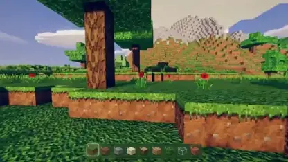</a><br>
<strong>A single-file Minecraft with HDR lighting</strong><br>
<sub><a href="prompts/rezait00-997344.md">View details · GitHub</a> · <a href="media/rezait00-997344/video.b4ab38e80f.mp4">Watch video ↗</a> · <a href="https://x.com/RezAIT00/status/2119902470205997344">@RezAIT00 · Original post ↗</a></sub><br>
<sub>Games &amp; Interactive Experiences · Prompt not published · 2026-11-09</sub>
</td>
</tr>
</table>

[Browse all 35 examples →](data/categories/interactive.md)

## Product & Brand Videos — homepage picks

<table>
<tr>
<td width="33%" valign="top">
<a href="media/ercankeskinx-713531/video.6d736b85e1.mp4"></a><br>
<strong>A complete launch film for Vela AI</strong><br>
<sub><a href="prompts/ercankeskinx-713531.md">View details · GitHub</a> · <a href="media/ercankeskinx-713531/video.6d736b85e1.mp4">Watch video ↗</a> · <a href="https://x.com/ercankeskinx/status/2120147659306713531">@ercankeskinx · Original post ↗</a></sub><br>
<sub>Product &amp; Brand Videos · Prompt not published · 2026-11-10</sub>
</td>
<td width="33%" valign="top">
<a href="media/grafikcem-937806/video.027c0f3509.mp4"></a><br>
<strong>Fable 5.2 animates its own announcement</strong><br>
<sub><a href="prompts/grafikcem-937806.md">View prompt · GitHub</a> · <a href="media/grafikcem-937806/video.027c0f3509.mp4">Watch video ↗</a> · <a href="https://x.com/grafikcem/status/2119910525064937806">@grafikcem · Original post ↗</a></sub><br>
<sub>Product &amp; Brand Videos · Public prompt · 2026-11-09</sub>
</td>
<td width="33%" valign="top">
<a href="media/hugo-grndd-723615/video.e9a963b06b.mp4"></a><br>
<strong>A CRM product film made in 15 minutes</strong><br>
<sub><a href="prompts/hugo-grndd-723615.md">View details · GitHub</a> · <a href="media/hugo-grndd-723615/video.e9a963b06b.mp4">Watch video ↗</a> · <a href="https://x.com/hugo_grndd/status/2119909979381723615">@hugo_grndd · Original post ↗</a></sub><br>
<sub>Product &amp; Brand Videos · Prompt not published · 2026-11-09</sub>
</td>
</tr>
<tr>
<td width="33%" valign="top">
<a href="media/webilyco-626667/video.285fdba2e4.mp4">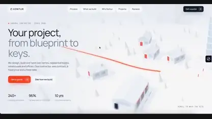</a><br>
<strong>A construction site landing page in 3D</strong><br>
<sub><a href="prompts/webilyco-626667.md">View details · GitHub</a> · <a href="media/webilyco-626667/video.285fdba2e4.mp4">Watch video ↗</a> · <a href="https://x.com/Webilyco/status/2119909604431626667">@Webilyco · Original post ↗</a></sub><br>
<sub>Product &amp; Brand Videos · Prompt not published · 2026-11-09</sub>
</td>
<td width="33%" valign="top">
<a href="media/geniusyinka-832704/video.4fcd35d163.mp4">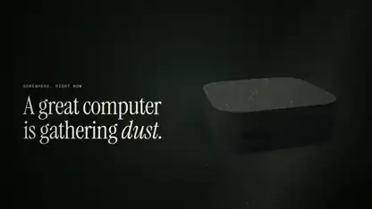</a><br>
<strong>A launch film for refurbished Macs</strong><br>
<sub><a href="prompts/geniusyinka-832704.md">View details · GitHub</a> · <a href="media/geniusyinka-832704/video.4fcd35d163.mp4">Watch video ↗</a> · <a href="https://x.com/geniusyinka/status/2119906654149832704">@geniusyinka · Original post ↗</a></sub><br>
<sub>Product &amp; Brand Videos · Prompt not published · 2026-11-09</sub>
</td>
<td width="33%" valign="top">
<a href="media/pratyushrungta-945416/video.6e0929d3a8.mp4">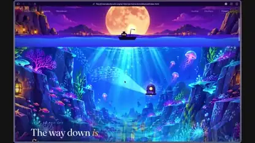</a><br>
<strong>A landing page that scrolls into the ocean</strong><br>
<sub><a href="prompts/pratyushrungta-945416.md">View details · GitHub</a> · <a href="media/pratyushrungta-945416/video.6e0929d3a8.mp4">Watch video ↗</a> · <a href="https://x.com/pratyushrungta/status/2119903348354945416">@pratyushrungta · Original post ↗</a></sub><br>
<sub>Product &amp; Brand Videos · Prompt not published · 2026-11-09</sub>
</td>
</tr>
</table>

[Browse all 24 examples →](data/categories/promo.md)

## Attribution and source

Imported from [yihui-dev/awesome-fable5-2-videos](https://github.com/yihui-dev/awesome-fable5-2-videos). All original index fields, creator credits, prompt text and source-post links are preserved. The original README is archived in [data/upstream/README.md](data/upstream/README.md).

Entries without a disclosed prompt are labelled **Prompt not published**; their post text is not presented as a prompt. Videos and images remain the work of their original creators. The upstream repository’s MIT license is preserved in [LICENSE](LICENSE).

## Clone with all videos

Individual case videos are stored with Git LFS.

```bash
git lfs install
git clone https://github.com/LeaddeOpenLab/awesome-fable-5.2-video-prompts.git
cd awesome-fable-5.2-video-prompts
git lfs pull
```

## Data and maintenance

- [Original machine-readable index](data/videos.json)
- [Local media paths and tags](data/local-media.json)
- `python3 scripts/download-media.py` downloads only media URLs already in the index.
- `python3 scripts/build-catalog.py` rebuilds the cards.
- `python3 scripts/check-catalog.py` checks local media, prompts and source links.

X discovery is not started by this repository or these scripts.
