# 3D Worlds & Simulations

[← Full library](../../README.md)

58 examples · Original creator links on every card.

<table>
<tr>
<td width="33%" valign="top">
<a href="../../media/handsher-ngu-789655/video.0e1caaf3a5.mp4">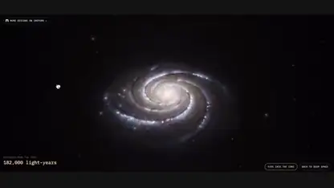</a> 
<strong>Fly into a spiral galaxy</strong> 
<a href="../../prompts/handsher-ngu-789655.md">View details · GitHub</a> · <a href="../../media/handsher-ngu-789655/video.0e1caaf3a5.mp4">Watch video ↗</a> · <a href="https://x.com/handsher_NGU/status/2119910478025789655">@handsher_NGU · Original post ↗</a> 
3D Worlds &amp; Simulations · Prompt not published · 2026-11-09
</td>
<td width="33%" valign="top">
 
<strong>Paris in 1940, rebuilt in Three.js</strong> 
<a href="../../prompts/higgsfield-ai-912507.md">View details · GitHub</a> · <a href="../../media/higgsfield-ai-912507/video.9bea26ab46.mp4">Watch video ↗</a> · <a href="https://x.com/higgsfield_ai/status/2119910344998912507">@higgsfield_ai · Original post ↗</a> 
3D Worlds &amp; Simulations · Prompt not published · 2026-11-09
</td>
<td width="33%" valign="top">
<a href="../../media/scratcherrrr-785332/video.d720d4afc3.mp4">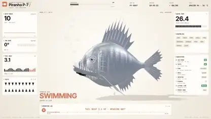</a> 
<strong>A 3D piranha that takes itself apart</strong> 
<a href="../../prompts/scratcherrrr-785332.md">View details · GitHub</a> · <a href="../../media/scratcherrrr-785332/video.d720d4afc3.mp4">Watch video ↗</a> · <a href="https://x.com/Scratcherrrr/status/2119909780269785332">@Scratcherrrr · Original post ↗</a> 
3D Worlds &amp; Simulations · Prompt not published · 2026-11-09
</td>
</tr>
<tr>
<td width="33%" valign="top">
<a href="../../media/s-matysik-213380/video.fe34f48203.mp4">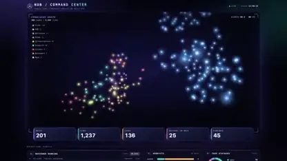</a> 
<strong>A command center for an agent system</strong> 
<a href="../../prompts/s-matysik-213380.md">View details · GitHub</a> · <a href="../../media/s-matysik-213380/video.fe34f48203.mp4">Watch video ↗</a> · <a href="https://x.com/s_matysik/status/2119909371484213380">@s_matysik · Original post ↗</a> 
3D Worlds &amp; Simulations · Prompt not published · 2026-11-09
</td>
<td width="33%" valign="top">
<a href="../../media/higgsfield-ai-342326/video.3682838fd4.mp4">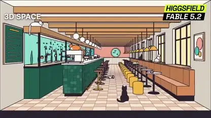</a> 
<strong>A flat sketch becomes a textured 3D room</strong> 
<a href="../../prompts/higgsfield-ai-342326.md">View details · GitHub</a> · <a href="../../media/higgsfield-ai-342326/video.3682838fd4.mp4">Watch video ↗</a> · <a href="https://x.com/higgsfield_ai/status/2119908486880342326">@higgsfield_ai · Original post ↗</a> 
3D Worlds &amp; Simulations · Prompt not published · 2026-11-09
</td>
<td width="33%" valign="top">
<a href="../../media/higgsfield-ai-496421/video.e43242ac59.mp4">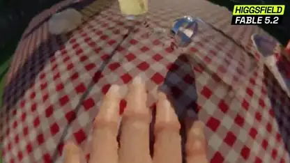</a> 
<strong>The world through a fly&#x27;s eyes</strong> 
<a href="../../prompts/higgsfield-ai-496421.md">View details · GitHub</a> · <a href="../../media/higgsfield-ai-496421/video.e43242ac59.mp4">Watch video ↗</a> · <a href="https://x.com/higgsfield_ai/status/2119907841599496421">@higgsfield_ai · Original post ↗</a> 
3D Worlds &amp; Simulations · Prompt not published · 2026-11-09
</td>
</tr>
<tr>
<td width="33%" valign="top">
 
<strong>A voxel pagoda full of tiny details</strong> 
<a href="../../prompts/luminabench-657696.md">View details · GitHub</a> · <a href="../../media/luminabench-657696/video.66d8b50639.mp4">Watch video ↗</a> · <a href="https://x.com/LuminaBench/status/2119907096636657696">@LuminaBench · Original post ↗</a> 
3D Worlds &amp; Simulations · Prompt not published · 2026-11-09
</td>
<td width="33%" valign="top">
<a href="../../media/fuoeba-307074/video.e85a10e5fc.mp4">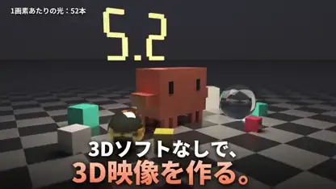</a> 
<strong>A ray tracer written from scratch, no 3D software</strong> 
<a href="../../prompts/fuoeba-307074.md">View details · GitHub</a> · <a href="../../media/fuoeba-307074/video.e85a10e5fc.mp4">Watch video ↗</a> · <a href="https://x.com/fuoeba/status/2119906486017307074">@fuoeba · Original post ↗</a> 
3D Worlds &amp; Simulations · Prompt not published · 2026-11-09
</td>
<td width="33%" valign="top">
 
<strong>A Mexico City market built entirely in code</strong> 
<a href="../../prompts/higgsfield-ai-945977.md">View details · GitHub</a> · <a href="../../media/higgsfield-ai-945977/video.8b0d486123.mp4">Watch video ↗</a> · <a href="https://x.com/higgsfield_ai/status/2119906341078945977">@higgsfield_ai · Original post ↗</a> 
3D Worlds &amp; Simulations · Prompt not published · 2026-11-09
</td>
</tr>
<tr>
<td width="33%" valign="top">
<a href="../../media/josendev-845704/video.82487c18ae.mp4">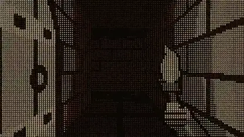</a> 
<strong>An ASCII dungeon animation remade</strong> 
<a href="../../prompts/josendev-845704.md">View details · GitHub</a> · <a href="../../media/josendev-845704/video.82487c18ae.mp4">Watch video ↗</a> · <a href="https://x.com/josendev/status/2119906280118845704">@josendev · Original post ↗</a> 
3D Worlds &amp; Simulations · Prompt not published · 2026-11-09
</td>
<td width="33%" valign="top">
<a href="../../media/sprinntt-988961/video.251bbc9753.mp4">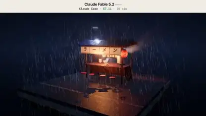</a> 
<strong>A ramen stall on a rainy Tokyo night</strong> 
<a href="../../prompts/sprinntt-988961.md">View details · GitHub</a> · <a href="../../media/sprinntt-988961/video.251bbc9753.mp4">Watch video ↗</a> · <a href="https://x.com/sprinntt/status/2119906202330988961">@sprinntt · Original post ↗</a> 
3D Worlds &amp; Simulations · Prompt not published · 2026-11-09
</td>
<td width="33%" valign="top">
 
<strong>A pirate ship sailing across the ocean</strong> 
<a href="../../prompts/notjazii-122575.md">View details · GitHub</a> · <a href="../../media/notjazii-122575/video.4d67b5c657.mp4">Watch video ↗</a> · <a href="https://x.com/notjazii/status/2119905661505122575">@notjazii · Original post ↗</a> 
3D Worlds &amp; Simulations · Prompt not published · 2026-11-09
</td>
</tr>
<tr>
<td width="33%" valign="top">
<a href="../../media/mooncastonline-145963/video.d36337144f.mp4">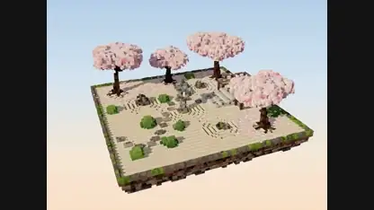</a> 
<strong>A voxel Japanese tea garden</strong> 
<a href="../../prompts/mooncastonline-145963.md">View details · GitHub</a> · <a href="../../media/mooncastonline-145963/video.d36337144f.mp4">Watch video ↗</a> · <a href="https://x.com/MooncastOnline/status/2119905190254145963">@MooncastOnline · Original post ↗</a> 
3D Worlds &amp; Simulations · Prompt not published · 2026-11-09
</td>
<td width="33%" valign="top">
 
<strong>A rainy Tokyo alley made without a video model</strong> 
<a href="../../prompts/higgsfield-ai-484595.md">View details · GitHub</a> · <a href="../../media/higgsfield-ai-484595/video.14b644e4f3.mp4">Watch video ↗</a> · <a href="https://x.com/higgsfield_ai/status/2119905141822484595">@higgsfield_ai · Original post ↗</a> 
3D Worlds &amp; Simulations · Prompt not published · 2026-11-09
</td>
<td width="33%" valign="top">
<a href="../../media/adityavg13-799971/video.7d5fa4123e.mp4">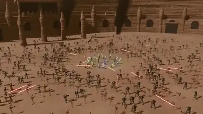</a> 
<strong>A Star Wars battle built in Blender</strong> 
<a href="../../prompts/adityavg13-799971.md">View details · GitHub</a> · <a href="../../media/adityavg13-799971/video.7d5fa4123e.mp4">Watch video ↗</a> · <a href="https://x.com/adityavg13/status/2119903463735799971">@adityavg13 · Original post ↗</a> 
3D Worlds &amp; Simulations · Prompt not published · 2026-11-09
</td>
</tr>
<tr>
<td width="33%" valign="top">
 
<strong>A synth keyboard film with custom sound design</strong> 
<a href="../../prompts/amirmushich-564844.md">View details · GitHub</a> · <a href="../../media/amirmushich-564844/video.a62901ce78.mp4">Watch video ↗</a> · <a href="https://x.com/AmirMushich/status/2119903338078564844">@AmirMushich · Original post ↗</a> 
3D Worlds &amp; Simulations · Prompt not published · 2026-11-09
</td>
<td width="33%" valign="top">
<a href="../../media/pleometric-186234/video.3058a7057a.mp4">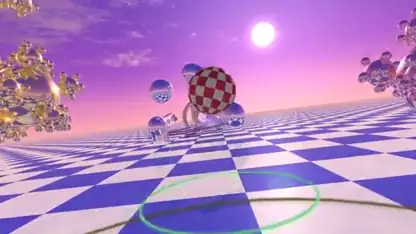</a> 
<strong>A tribute to 90s Bryce ray tracing</strong> 
<a href="../../prompts/pleometric-186234.md">View details · GitHub</a> · <a href="../../media/pleometric-186234/video.3058a7057a.mp4">Watch video ↗</a> · <a href="https://x.com/pleometric/status/2119901747930186234">@pleometric · Original post ↗</a> 
3D Worlds &amp; Simulations · Prompt not published · 2026-11-09
</td>
<td width="33%" valign="top">
<a href="../../media/kplikethebird-902732/video.7395e83d4c.mp4">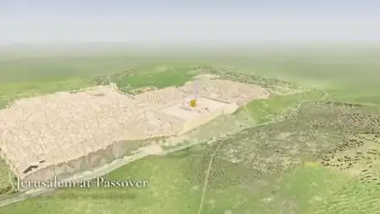</a> 
<strong>An immersive 3D model of ancient Jerusalem</strong> 
<a href="../../prompts/kplikethebird-902732.md">View prompt · GitHub</a> · <a href="../../media/kplikethebird-902732/video.7395e83d4c.mp4">Watch video ↗</a> · <a href="https://x.com/kplikethebird/status/2119900775727902732">@kplikethebird · Original post ↗</a> 
3D Worlds &amp; Simulations · Public prompt · 2026-11-09
</td>
</tr>
<tr>
<td width="33%" valign="top">
 
<strong>A lighthouse in a storm</strong> 
<a href="../../prompts/rohit3a-487954.md">View details · GitHub</a> · <a href="../../media/rohit3a-487954/video.d6d3e76ea8.mp4">Watch video ↗</a> · <a href="https://x.com/rohit3a/status/2119899684999487954">@rohit3a · Original post ↗</a> 
3D Worlds &amp; Simulations · Prompt not published · 2026-11-09
</td>
<td width="33%" valign="top">
<a href="../../media/sakshamships-310965/video.4d512b0a3f.mp4">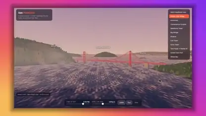</a> 
<strong>San Francisco modeled in 15 minutes</strong> 
<a href="../../prompts/sakshamships-310965.md">View details · GitHub</a> · <a href="../../media/sakshamships-310965/video.4d512b0a3f.mp4">Watch video ↗</a> · <a href="https://x.com/sakshamships/status/2119898573135310965">@sakshamships · Original post ↗</a> 
3D Worlds &amp; Simulations · Prompt not published · 2026-11-09
</td>
<td width="33%" valign="top">
 
<strong>A PS2-style nuclear explosion</strong> 
<a href="../../prompts/convictionfaq-937131.md">View details · GitHub</a> · <a href="../../media/convictionfaq-937131/video.02b5cf05d8.mp4">Watch video ↗</a> · <a href="https://x.com/ConvictionFAQ/status/2119898203088937131">@ConvictionFAQ · Original post ↗</a> 
3D Worlds &amp; Simulations · Prompt not published · 2026-11-09
</td>
</tr>
<tr>
<td width="33%" valign="top">
<a href="../../media/0xve1vet-849204/video.98b809b8d2.mp4">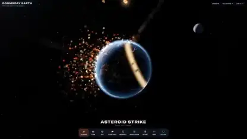</a> 
<strong>Earth in space with eight ways to destroy it</strong> 
<a href="../../prompts/0xve1vet-849204.md">View details · GitHub</a> · <a href="../../media/0xve1vet-849204/video.98b809b8d2.mp4">Watch video ↗</a> · <a href="https://x.com/0xVe1vet/status/2119896809669849204">@0xVe1vet · Original post ↗</a> 
3D Worlds &amp; Simulations · Prompt not published · 2026-11-09
</td>
<td width="33%" valign="top">
<a href="../../media/maxt3chno-467952/video.16700423ec.mp4">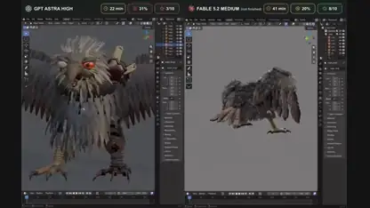</a> 
<strong>A zombie eagle sculpted through Blender MCP</strong> 
<a href="../../prompts/maxt3chno-467952.md">View prompt · GitHub</a> · <a href="../../media/maxt3chno-467952/video.16700423ec.mp4">Watch video ↗</a> · <a href="https://x.com/maxt3chno/status/2119896698281467952">@maxt3chno · Original post ↗</a> 
3D Worlds &amp; Simulations · Public prompt · 2026-11-09
</td>
<td width="33%" valign="top">
 
<strong>A car configurator made on medium thinking</strong> 
<a href="../../prompts/rezait00-020389.md">View details · GitHub</a> · <a href="../../media/rezait00-020389/video.b90ea1481e.mp4">Watch video ↗</a> · <a href="https://x.com/RezAIT00/status/2119896578987020389">@RezAIT00 · Original post ↗</a> 
3D Worlds &amp; Simulations · Prompt not published · 2026-11-09
</td>
</tr>
<tr>
<td width="33%" valign="top">
 
<strong>A voxel island with a cycling pelican</strong> 
<a href="../../prompts/filicroval-811943.md">View details · GitHub</a> · <a href="../../media/filicroval-811943/video.b4d07a8278.mp4">Watch video ↗</a> · <a href="https://x.com/filicroval/status/2119896439010811943">@filicroval · Original post ↗</a> 
3D Worlds &amp; Simulations · Prompt not published · 2026-11-09
</td>
<td width="33%" valign="top">
 
<strong>A photorealistic lighthouse at sunset</strong> 
<a href="../../prompts/viewsfrom02108-437907.md">View details · GitHub</a> · <a href="../../media/viewsfrom02108-437907/video.4c702da674.mp4">Watch video ↗</a> · <a href="https://x.com/viewsfrom02108/status/2119896345729437907">@viewsfrom02108 · Original post ↗</a> 
3D Worlds &amp; Simulations · Prompt not published · 2026-11-09
</td>
<td width="33%" valign="top">
<a href="../../media/zirkomirko-529121/video.bccb17bf92.mp4">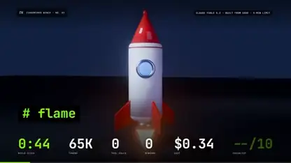</a> 
<strong>A rocket launch built in under two minutes</strong> 
<a href="../../prompts/zirkomirko-529121.md">View details · GitHub</a> · <a href="../../media/zirkomirko-529121/video.bccb17bf92.mp4">Watch video ↗</a> · <a href="https://x.com/ZirkoMirko/status/2119896335843529121">@ZirkoMirko · Original post ↗</a> 
3D Worlds &amp; Simulations · Prompt not published · 2026-11-09
</td>
</tr>
<tr>
<td width="33%" valign="top">
<a href="../../media/ldataengineer-146101/video.1e4d794a7c.mp4">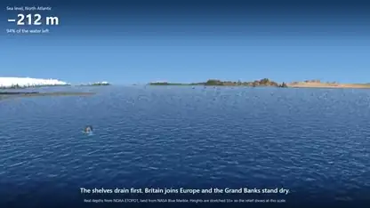</a> 
<strong>What Earth looks like with the oceans drained</strong> 
<a href="../../prompts/ldataengineer-146101.md">View details · GitHub</a> · <a href="../../media/ldataengineer-146101/video.1e4d794a7c.mp4">Watch video ↗</a> · <a href="https://x.com/Ldataengineer/status/2119896030993146101">@Ldataengineer · Original post ↗</a> 
3D Worlds &amp; Simulations · Prompt not published · 2026-11-09
</td>
<td width="33%" valign="top">
 
<strong>A Three.js ocean at sunset</strong> 
<a href="../../prompts/ericskavinski-016005.md">View details · GitHub</a> · <a href="../../media/ericskavinski-016005/video.0dbc77c6a7.mp4">Watch video ↗</a> · <a href="https://x.com/ericskavinski/status/2119895601580016005">@ericskavinski · Original post ↗</a> 
3D Worlds &amp; Simulations · Prompt not published · 2026-11-09
</td>
<td width="33%" valign="top">
<a href="../../media/higgsfield-ai-168558/video.7e7b1fdf71.mp4">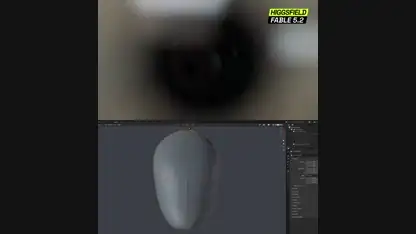</a> 
<strong>An android head built from a 360 video</strong> 
<a href="../../prompts/higgsfield-ai-168558.md">View details · GitHub</a> · <a href="../../media/higgsfield-ai-168558/video.7e7b1fdf71.mp4">Watch video ↗</a> · <a href="https://x.com/higgsfield_ai/status/2119895459519168558">@higgsfield_ai · Original post ↗</a> 
3D Worlds &amp; Simulations · Prompt not published · 2026-11-09
</td>
</tr>
<tr>
<td width="33%" valign="top">
 
<strong>A voxel Paris packed with detail</strong> 
<a href="../../prompts/rezait00-767656.md">View prompt · GitHub</a> · <a href="../../media/rezait00-767656/video.a21bba48a6.mp4">Watch video ↗</a> · <a href="https://x.com/RezAIT00/status/2119894257519767656">@RezAIT00 · Original post ↗</a> 
3D Worlds &amp; Simulations · Public prompt · 2026-11-09
</td>
<td width="33%" valign="top">
 
<strong>A seaplane skimming the water</strong> 
<a href="../../prompts/luminabench-807746.md">View details · GitHub</a> · <a href="../../media/luminabench-807746/video.1873b75f61.mp4">Watch video ↗</a> · <a href="https://x.com/LuminaBench/status/2119894130943807746">@LuminaBench · Original post ↗</a> 
3D Worlds &amp; Simulations · Prompt not published · 2026-11-09
</td>
<td width="33%" valign="top">
 
<strong>A ditherpunk Saturn</strong> 
<a href="../../prompts/josendev-730048.md">View details · GitHub</a> · <a href="../../media/josendev-730048/video.d0c23929be.mp4">Watch video ↗</a> · <a href="https://x.com/josendev/status/2119894060521730048">@josendev · Original post ↗</a> 
3D Worlds &amp; Simulations · Prompt not published · 2026-11-09
</td>
</tr>
<tr>
<td width="33%" valign="top">
<a href="../../media/higgsfield-ai-490135/video.e3ae90993a.mp4">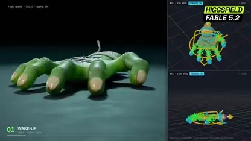</a> 
<strong>A rigged zombie hand that crawls and backflips</strong> 
<a href="../../prompts/higgsfield-ai-490135.md">View prompt · GitHub</a> · <a href="../../media/higgsfield-ai-490135/video.e3ae90993a.mp4">Watch video ↗</a> · <a href="https://x.com/higgsfield_ai/status/2119893970897490135">@higgsfield_ai · Original post ↗</a> 
3D Worlds &amp; Simulations · Public prompt · 2026-11-09
</td>
<td width="33%" valign="top">
<a href="../../media/abhinavflac-859332/video.a6c63a77e0.mp4">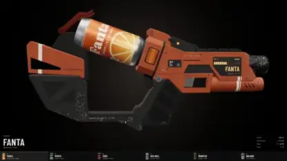</a> 
<strong>Sci-fi blasters built around soda cans</strong> 
<a href="../../prompts/abhinavflac-859332.md">View details · GitHub</a> · <a href="../../media/abhinavflac-859332/video.a6c63a77e0.mp4">Watch video ↗</a> · <a href="https://x.com/abhinavflac/status/2119893868816859332">@abhinavflac · Original post ↗</a> 
3D Worlds &amp; Simulations · Prompt not published · 2026-11-09
</td>
<td width="33%" valign="top">
<a href="../../media/simonasltu1-622262/video.5531e77583.mp4">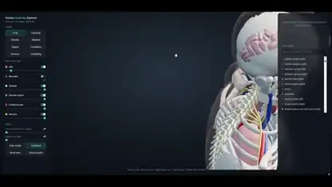</a> 
<strong>A human anatomy explorer in Three.js</strong> 
<a href="../../prompts/simonasltu1-622262.md">View details · GitHub</a> · <a href="../../media/simonasltu1-622262/video.5531e77583.mp4">Watch video ↗</a> · <a href="https://x.com/SimonasLTU1/status/2119891671219622262">@SimonasLTU1 · Original post ↗</a> 
3D Worlds &amp; Simulations · Prompt not published · 2026-11-09
</td>
</tr>
<tr>
<td width="33%" valign="top">
 
<strong>Glass, amber and liquid metal type</strong> 
<a href="../../prompts/iotanjiro-606534.md">View details · GitHub</a> · <a href="../../media/iotanjiro-606534/video.1176805203.mp4">Watch video ↗</a> · <a href="https://x.com/ioTanjiro/status/2119891527438606534">@ioTanjiro · Original post ↗</a> 
3D Worlds &amp; Simulations · Prompt not published · 2026-11-09
</td>
<td width="33%" valign="top">
 
<strong>A golden sailing ship above the clouds</strong> 
<a href="../../prompts/marcthecreatorr-054072.md">View details · GitHub</a> · <a href="../../media/marcthecreatorr-054072/video.4379fb2274.mp4">Watch video ↗</a> · <a href="https://x.com/marcthecreatorr/status/2119890973560054072">@marcthecreatorr · Original post ↗</a> 
3D Worlds &amp; Simulations · Prompt not published · 2026-11-09
</td>
<td width="33%" valign="top">
 
<strong>A pocket black hole</strong> 
<a href="../../prompts/paulgrowthlab-499382.md">View details · GitHub</a> · <a href="../../media/paulgrowthlab-499382/video.4be43d3225.mp4">Watch video ↗</a> · <a href="https://x.com/paulgrowthlab/status/2119890500979499382">@paulgrowthlab · Original post ↗</a> 
3D Worlds &amp; Simulations · Prompt not published · 2026-11-09
</td>
</tr>
<tr>
<td width="33%" valign="top">
<a href="../../media/higgsfield-ai-938248/video.04d8aa74ac.mp4">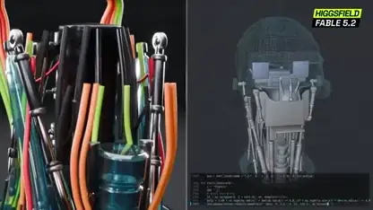</a> 
<strong>3D models built from reference videos</strong> 
<a href="../../prompts/higgsfield-ai-938248.md">View prompt · GitHub</a> · <a href="../../media/higgsfield-ai-938248/video.04d8aa74ac.mp4">Watch video ↗</a> · <a href="https://x.com/higgsfield_ai/status/2119890046748938248">@higgsfield_ai · Original post ↗</a> 
3D Worlds &amp; Simulations · Public prompt · 2026-11-09
</td>
<td width="33%" valign="top">
<a href="../../media/trymirage-972028/video.86fdce8977.mp4">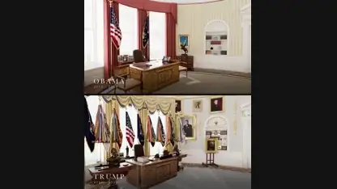</a> 
<strong>The White House, then and now</strong> 
<a href="../../prompts/trymirage-972028.md">View details · GitHub</a> · <a href="../../media/trymirage-972028/video.86fdce8977.mp4">Watch video ↗</a> · <a href="https://x.com/trymirage/status/2119889897200972028">@trymirage · Original post ↗</a> 
3D Worlds &amp; Simulations · Prompt not published · 2026-11-09
</td>
<td width="33%" valign="top">
 
<strong>A lighthouse keeper short film</strong> 
<a href="../../prompts/marvellousdev-380563.md">View details · GitHub</a> · <a href="../../media/marvellousdev-380563/video.ad82ab9a6d.mp4">Watch video ↗</a> · <a href="https://x.com/MarvellousDev/status/2119889511333380563">@MarvellousDev · Original post ↗</a> 
3D Worlds &amp; Simulations · Prompt not published · 2026-11-09
</td>
</tr>
<tr>
<td width="33%" valign="top">
 
<strong>An ocean from golden hour to storm</strong> 
<a href="../../prompts/zrymiller-106941.md">View details · GitHub</a> · <a href="../../media/zrymiller-106941/video.ec9d58fb72.mp4">Watch video ↗</a> · <a href="https://x.com/ZryMiller/status/2119887758777106941">@ZryMiller · Original post ↗</a> 
3D Worlds &amp; Simulations · Prompt not published · 2026-11-09
</td>
<td width="33%" valign="top">
 
<strong>A UFO lands at Area 51</strong> 
<a href="../../prompts/danteeonsol-077213.md">View prompt · GitHub</a> · <a href="../../media/danteeonsol-077213/video.c14ad50806.mp4">Watch video ↗</a> · <a href="https://x.com/danteeonsol/status/2119887623070077213">@danteeonsol · Original post ↗</a> 
3D Worlds &amp; Simulations · Public prompt · 2026-11-09
</td>
<td width="33%" valign="top">
 
<strong>A galaxy rendered in 20 minutes</strong> 
<a href="../../prompts/handsher-ngu-863367.md">View details · GitHub</a> · <a href="../../media/handsher-ngu-863367/video.de27a0ec31.mp4">Watch video ↗</a> · <a href="https://x.com/handsher_NGU/status/2119887298292863367">@handsher_NGU · Original post ↗</a> 
3D Worlds &amp; Simulations · Prompt not published · 2026-11-09
</td>
</tr>
<tr>
<td width="33%" valign="top">
<a href="../../media/scottstts-734829/video.28340d5d95.mp4">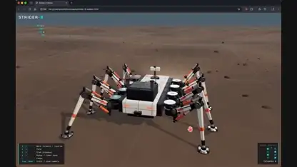</a> 
<strong>An eight-legged mechanical rover</strong> 
<a href="../../prompts/scottstts-734829.md">View details · GitHub</a> · <a href="../../media/scottstts-734829/video.28340d5d95.mp4">Watch video ↗</a> · <a href="https://x.com/scottstts/status/2119886562003734829">@scottstts · Original post ↗</a> 
3D Worlds &amp; Simulations · Prompt not published · 2026-11-09
</td>
<td width="33%" valign="top">
 
<strong>A travel ad for Fushimi Inari in autumn</strong> 
<a href="../../prompts/petergyang-854431.md">View details · GitHub</a> · <a href="../../media/petergyang-854431/video.af2ff3278e.mp4">Watch video ↗</a> · <a href="https://x.com/petergyang/status/2119886560992854431">@petergyang · Original post ↗</a> 
3D Worlds &amp; Simulations · Prompt not published · 2026-11-09
</td>
<td width="33%" valign="top">
 
<strong>Laundry on a line in the afternoon light</strong> 
<a href="../../prompts/dfeinition-625062.md">View details · GitHub</a> · <a href="../../media/dfeinition-625062/video.24873fc95c.mp4">Watch video ↗</a> · <a href="https://x.com/dfeinition/status/2119886262211625062">@dfeinition · Original post ↗</a> 
3D Worlds &amp; Simulations · Prompt not published · 2026-11-09
</td>
</tr>
<tr>
<td width="33%" valign="top">
 
<strong>A spider weaves a logo into its web</strong> 
<a href="../../prompts/sudophoenix-655872.md">View details · GitHub</a> · <a href="../../media/sudophoenix-655872/video.449f88550e.mp4">Watch video ↗</a> · <a href="https://x.com/sudoPhoeniX/status/2119885209621655872">@sudoPhoeniX · Original post ↗</a> 
3D Worlds &amp; Simulations · Prompt not published · 2026-11-09
</td>
<td width="33%" valign="top">
<a href="../../media/tekonburns-963500/video.0d0a5d63d3.mp4">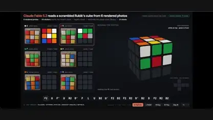</a> 
<strong>A Rubik&#x27;s cube solved from six photos</strong> 
<a href="../../prompts/tekonburns-963500.md">View details · GitHub</a> · <a href="../../media/tekonburns-963500/video.0d0a5d63d3.mp4">Watch video ↗</a> · <a href="https://x.com/TekonBurns/status/2119880835121963500">@TekonBurns · Original post ↗</a> 
3D Worlds &amp; Simulations · Prompt not published · 2026-11-09
</td>
<td width="33%" valign="top">
 
<strong>A rainy night drive through Mirror Earth</strong> 
<a href="../../prompts/mattshumer-766782.md">View details · GitHub</a> · <a href="../../media/mattshumer-766782/video.a7080b81a5.mp4">Watch video ↗</a> · <a href="https://x.com/mattshumer_/status/2119879860344766782">@mattshumer_ · Original post ↗</a> 
3D Worlds &amp; Simulations · Prompt not published · 2026-11-09
</td>
</tr>
<tr>
<td width="33%" valign="top">
<a href="../../media/petergostev-394520/video.44bd69d564.mp4">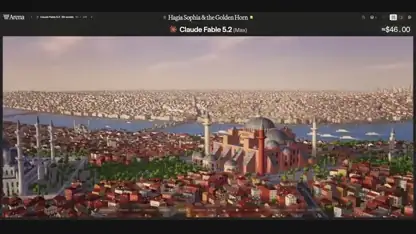</a> 
<strong>Istanbul, built from a prompt</strong> 
<a href="../../prompts/petergostev-394520.md">View details · GitHub</a> · <a href="../../media/petergostev-394520/video.44bd69d564.mp4">Watch video ↗</a> · <a href="https://x.com/petergostev/status/2119877733488394520">@petergostev · Original post ↗</a> 
3D Worlds &amp; Simulations · Prompt not published · 2026-11-09
</td>
<td width="33%" valign="top">
<a href="../../media/hello-amani-237842/video.d8de25056e.mp4">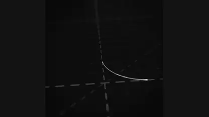</a> 
<strong>A chrome logo reveal in 3D</strong> 
<a href="../../prompts/hello-amani-237842.md">View prompt · GitHub</a> · <a href="../../media/hello-amani-237842/video.d8de25056e.mp4">Watch video ↗</a> · <a href="https://x.com/hello_amani/status/2119873980786237842">@hello_amani · Original post ↗</a> 
3D Worlds &amp; Simulations · Public prompt · 2026-11-09
</td>
<td width="33%" valign="top">
 
<strong>The Battle of New York in 3D</strong> 
<a href="../../prompts/hammer-mt-346319.md">View details · GitHub</a> · <a href="../../media/hammer-mt-346319/video.60214bbd68.mp4">Watch video ↗</a> · <a href="https://x.com/hammer_mt/status/2119871817561346319">@hammer_mt · Original post ↗</a> 
3D Worlds &amp; Simulations · Prompt not published · 2026-11-09
</td>
</tr>
<tr>
<td width="33%" valign="top">
<a href="../../media/tekonburns-660260/video.54414b575a.mp4">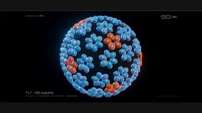</a> 
<strong>A virus capsid assembling itself</strong> 
<a href="../../prompts/tekonburns-660260.md">View details · GitHub</a> · <a href="../../media/tekonburns-660260/video.54414b575a.mp4">Watch video ↗</a> · <a href="https://x.com/TekonBurns/status/2119871565311660260">@TekonBurns · Original post ↗</a> 
3D Worlds &amp; Simulations · Prompt not published · 2026-11-09
</td>
<td width="33%" valign="top">
 
<strong>A destructible voxel city</strong> 
<a href="../../prompts/mattshumer-483384.md">View details · GitHub</a> · <a href="../../media/mattshumer-483384/video.70bd4b0c73.mp4">Watch video ↗</a> · <a href="https://x.com/mattshumer_/status/2119870965106483384">@mattshumer_ · Original post ↗</a> 
3D Worlds &amp; Simulations · Prompt not published · 2026-11-09
</td>
<td width="33%" valign="top">
 
<strong>A European village where every character thinks</strong> 
<a href="../../prompts/matthewberman-060195.md">View details · GitHub</a> · <a href="../../media/matthewberman-060195/video.60c8b9d76e.mp4">Watch video ↗</a> · <a href="https://x.com/MatthewBerman/status/2119868638929060195">@MatthewBerman · Original post ↗</a> 
3D Worlds &amp; Simulations · Prompt not published · 2026-11-09
</td>
</tr>
<tr>
<td width="33%" valign="top">
<a href="../../media/matthewberman-953017/video.e4589b6d8b.mp4">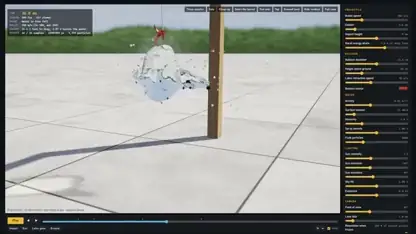</a> 
<strong>A bullet through a water balloon</strong> 
<a href="../../prompts/matthewberman-953017.md">View details · GitHub</a> · <a href="../../media/matthewberman-953017/video.e4589b6d8b.mp4">Watch video ↗</a> · <a href="https://x.com/MatthewBerman/status/2119868636810953017">@MatthewBerman · Original post ↗</a> 
3D Worlds &amp; Simulations · Prompt not published · 2026-11-09
</td>
</tr>
</table>
