# Games & Interactive Experiences

[← Full library](../../README.md)

35 examples · Original creator links on every card.

<table>
<tr>
<td width="33%" valign="top">
 
<strong>A Roblox horror game with its own trailer</strong> 
<a href="../../prompts/mihawkxxxxx-699749.md">View details · GitHub</a> · <a href="../../media/mihawkxxxxx-699749/video.46c597ffb0.mp4">Watch video ↗</a> · <a href="https://x.com/mihawkxxxxx/status/2119909865296699749">@mihawkxxxxx · Original post ↗</a> 
Games &amp; Interactive Experiences · Prompt not published · 2026-11-09
</td>
<td width="33%" valign="top">
<a href="../../media/itssotsot-491720/video.933d6a62a9.mp4">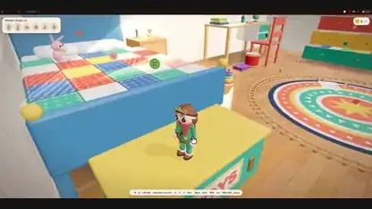</a> 
<strong>A toy-room adventure game</strong> 
<a href="../../prompts/itssotsot-491720.md">View details · GitHub</a> · <a href="../../media/itssotsot-491720/video.933d6a62a9.mp4">Watch video ↗</a> · <a href="https://x.com/itssotsot/status/2119909017216491720">@itssotsot · Original post ↗</a> 
Games &amp; Interactive Experiences · Prompt not published · 2026-11-09
</td>
<td width="33%" valign="top">
<a href="../../media/elizaveta-ai-125485/video.ef830060ba.mp4">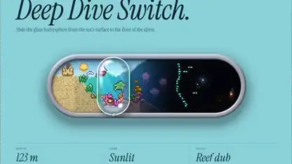</a> 
<strong>A deep-dive volume slider with an ocean inside</strong> 
<a href="../../prompts/elizaveta-ai-125485.md">View details · GitHub</a> · <a href="../../media/elizaveta-ai-125485/video.ef830060ba.mp4">Watch video ↗</a> · <a href="https://x.com/Elizaveta_ai/status/2119907947132125485">@Elizaveta_ai · Original post ↗</a> 
Games &amp; Interactive Experiences · Prompt not published · 2026-11-09
</td>
</tr>
<tr>
<td width="33%" valign="top">
<a href="../../media/evrentkg-272283/video.d34fc101e6.mp4">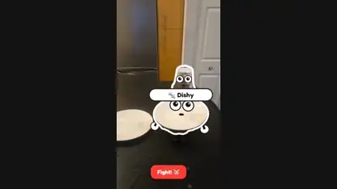</a> 
<strong>An AR battle game running on a phone</strong> 
<a href="../../prompts/evrentkg-272283.md">View details · GitHub</a> · <a href="../../media/evrentkg-272283/video.d34fc101e6.mp4">Watch video ↗</a> · <a href="https://x.com/evrentkg/status/2119905501601272283">@evrentkg · Original post ↗</a> 
Games &amp; Interactive Experiences · Prompt not published · 2026-11-09
</td>
<td width="33%" valign="top">
<a href="../../media/tymarsha-810582/video.521a86eb24.mp4">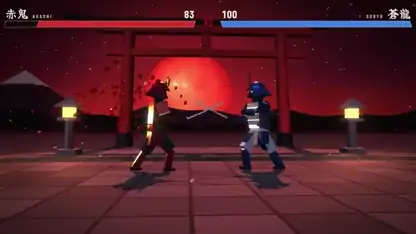</a> 
<strong>A samurai duel from one prompt</strong> 
<a href="../../prompts/tymarsha-810582.md">View details · GitHub</a> · <a href="../../media/tymarsha-810582/video.521a86eb24.mp4">Watch video ↗</a> · <a href="https://x.com/tymarsha/status/2119904015454810582">@tymarsha · Original post ↗</a> 
Games &amp; Interactive Experiences · Prompt not published · 2026-11-09
</td>
<td width="33%" valign="top">
<a href="../../media/rezait00-997344/video.b4ab38e80f.mp4">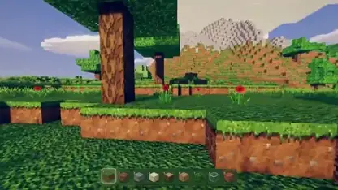</a> 
<strong>A single-file Minecraft with HDR lighting</strong> 
<a href="../../prompts/rezait00-997344.md">View details · GitHub</a> · <a href="../../media/rezait00-997344/video.b4ab38e80f.mp4">Watch video ↗</a> · <a href="https://x.com/RezAIT00/status/2119902470205997344">@RezAIT00 · Original post ↗</a> 
Games &amp; Interactive Experiences · Prompt not published · 2026-11-09
</td>
</tr>
<tr>
<td width="33%" valign="top">
<a href="../../media/petergyang-358005/video.3b551970a5.mp4">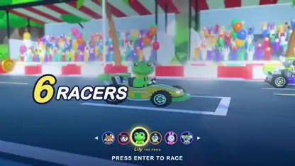</a> 
<strong>Turbo Tails, a 3D kart racer in the browser</strong> 
<a href="../../prompts/petergyang-358005.md">View details · GitHub</a> · <a href="../../media/petergyang-358005/video.3b551970a5.mp4">Watch video ↗</a> · <a href="https://x.com/petergyang/status/2119901658394358005">@petergyang · Original post ↗</a> 
Games &amp; Interactive Experiences · Prompt not published · 2026-11-09
</td>
<td width="33%" valign="top">
<a href="../../media/kevin-t-ngo-622171/video.38b529a208.mp4">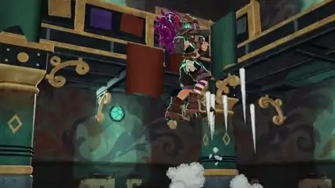</a> 
<strong>Gilt &amp; Gutter, a 1v1 browser shooter</strong> 
<a href="../../prompts/kevin-t-ngo-622171.md">View details · GitHub</a> · <a href="../../media/kevin-t-ngo-622171/video.38b529a208.mp4">Watch video ↗</a> · <a href="https://x.com/kevin_t_ngo/status/2119900487688622171">@kevin_t_ngo · Original post ↗</a> 
Games &amp; Interactive Experiences · Prompt not published · 2026-11-09
</td>
<td width="33%" valign="top">
<a href="../../media/teortaxestex-225567/video.49a8474013.mp4">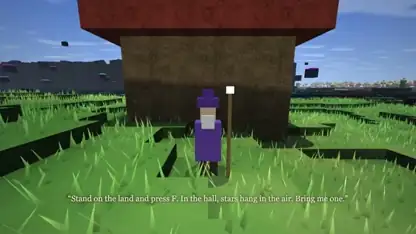</a> 
<strong>A Minecraft-style world in Three.js</strong> 
<a href="../../prompts/teortaxestex-225567.md">View details · GitHub</a> · <a href="../../media/teortaxestex-225567/video.49a8474013.mp4">Watch video ↗</a> · <a href="https://x.com/teortaxesTex/status/2119899511317225567">@teortaxesTex · Original post ↗</a> 
Games &amp; Interactive Experiences · Prompt not published · 2026-11-09
</td>
</tr>
<tr>
<td width="33%" valign="top">
<a href="../../media/repodoting-765513/video.45b30eadb3.mp4">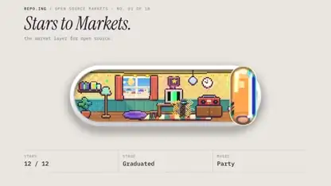</a> 
<strong>Sliders with little worlds inside</strong> 
<a href="../../prompts/repodoting-765513.md">View details · GitHub</a> · <a href="../../media/repodoting-765513/video.45b30eadb3.mp4">Watch video ↗</a> · <a href="https://x.com/repodoting/status/2119898879340765513">@repodoting · Original post ↗</a> 
Games &amp; Interactive Experiences · Prompt not published · 2026-11-09
</td>
<td width="33%" valign="top">
<a href="../../media/higgsfield-ai-529605/video.1a181ee09a.mp4">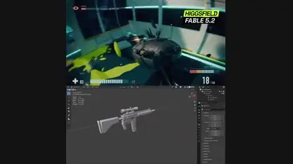</a> 
<strong>A sci-fi shooter built with Blender and Unreal</strong> 
<a href="../../prompts/higgsfield-ai-529605.md">View details · GitHub</a> · <a href="../../media/higgsfield-ai-529605/video.1a181ee09a.mp4">Watch video ↗</a> · <a href="https://x.com/higgsfield_ai/status/2119897113534529605">@higgsfield_ai · Original post ↗</a> 
Games &amp; Interactive Experiences · Prompt not published · 2026-11-09
</td>
<td width="33%" valign="top">
<a href="../../media/nft-chen-609967/video.c1ac3b7f85.mp4">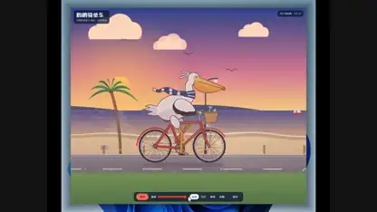</a> 
<strong>The pelican benchmark turned into a playable scene</strong> 
<a href="../../prompts/nft-chen-609967.md">View details · GitHub</a> · <a href="../../media/nft-chen-609967/video.c1ac3b7f85.mp4">Watch video ↗</a> · <a href="https://x.com/NFT_Chen/status/2119897058597609967">@NFT_Chen · Original post ↗</a> 
Games &amp; Interactive Experiences · Prompt not published · 2026-11-09
</td>
</tr>
<tr>
<td width="33%" valign="top">
<a href="../../media/pumpnasterr-609238/video.57178d093b.mp4">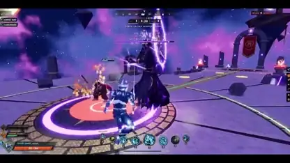</a> 
<strong>An Overwatch-style hero brawler</strong> 
<a href="../../prompts/pumpnasterr-609238.md">View details · GitHub</a> · <a href="../../media/pumpnasterr-609238/video.57178d093b.mp4">Watch video ↗</a> · <a href="https://x.com/Pumpnasterr/status/2119895877250609238">@Pumpnasterr · Original post ↗</a> 
Games &amp; Interactive Experiences · Prompt not published · 2026-11-09
</td>
<td width="33%" valign="top">
<a href="../../media/jonathanhamiche-145756/video.3433367649.mp4">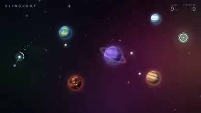</a> 
<strong>A gravity slingshot game with ten levels</strong> 
<a href="../../prompts/jonathanhamiche-145756.md">View details · GitHub</a> · <a href="../../media/jonathanhamiche-145756/video.3433367649.mp4">Watch video ↗</a> · <a href="https://x.com/jonathanhamiche/status/2119894929795145756">@jonathanhamiche · Original post ↗</a> 
Games &amp; Interactive Experiences · Prompt not published · 2026-11-09
</td>
<td width="33%" valign="top">
<a href="../../media/joshvlc-958575/video.d651899331.mp4">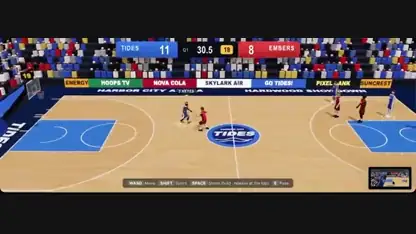</a> 
<strong>A one-shot basketball arena game</strong> 
<a href="../../prompts/joshvlc-958575.md">View prompt · GitHub</a> · <a href="../../media/joshvlc-958575/video.d651899331.mp4">Watch video ↗</a> · <a href="https://x.com/joshvlc/status/2119894656221958575">@joshvlc · Original post ↗</a> 
Games &amp; Interactive Experiences · Public prompt · 2026-11-09
</td>
</tr>
<tr>
<td width="33%" valign="top">
<a href="../../media/crtvteknologist-606617/video.45089d17cf.mp4">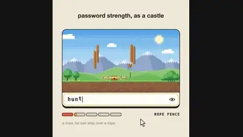</a> 
<strong>A password strength meter that builds a castle</strong> 
<a href="../../prompts/crtvteknologist-606617.md">View details · GitHub</a> · <a href="../../media/crtvteknologist-606617/video.45089d17cf.mp4">Watch video ↗</a> · <a href="https://x.com/crtvTeknologist/status/2119894073024606617">@crtvTeknologist · Original post ↗</a> 
Games &amp; Interactive Experiences · Prompt not published · 2026-11-09
</td>
<td width="33%" valign="top">
<a href="../../media/ozantrai-231568/video.d25d36ce14.mp4">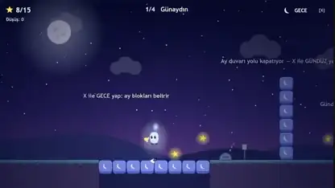</a> 
<strong>A day-and-night platformer</strong> 
<a href="../../prompts/ozantrai-231568.md">View details · GitHub</a> · <a href="../../media/ozantrai-231568/video.d25d36ce14.mp4">Watch video ↗</a> · <a href="https://x.com/OzanTRAI/status/2119893945895231568">@OzanTRAI · Original post ↗</a> 
Games &amp; Interactive Experiences · Prompt not published · 2026-11-09
</td>
<td width="33%" valign="top">
<a href="../../media/pratyushrungta-501310/video.81943a60e6.mp4">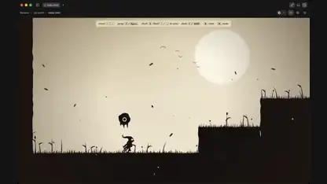</a> 
<strong>A Hollow Knight-style game in five minutes</strong> 
<a href="../../prompts/pratyushrungta-501310.md">View details · GitHub</a> · <a href="../../media/pratyushrungta-501310/video.81943a60e6.mp4">Watch video ↗</a> · <a href="https://x.com/pratyushrungta/status/2119891187511501310">@pratyushrungta · Original post ↗</a> 
Games &amp; Interactive Experiences · Prompt not published · 2026-11-09
</td>
</tr>
<tr>
<td width="33%" valign="top">
<a href="../../media/ashwinntwt-603459/video.56cac85f89.mp4">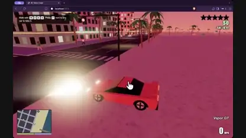</a> 
<strong>A GTA-inspired driving simulator</strong> 
<a href="../../prompts/ashwinntwt-603459.md">View details · GitHub</a> · <a href="../../media/ashwinntwt-603459/video.56cac85f89.mp4">Watch video ↗</a> · <a href="https://x.com/ashwinntwt/status/2119890312382603459">@ashwinntwt · Original post ↗</a> 
Games &amp; Interactive Experiences · Prompt not published · 2026-11-09
</td>
<td width="33%" valign="top">
<a href="../../media/0xbunny-391575/video.abf9fd59e5.mp4">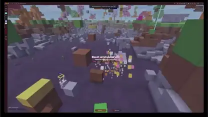</a> 
<strong>A voxel shooter made in 30 minutes</strong> 
<a href="../../prompts/0xbunny-391575.md">View details · GitHub</a> · <a href="../../media/0xbunny-391575/video.abf9fd59e5.mp4">Watch video ↗</a> · <a href="https://x.com/0xBunny/status/2119889077642391575">@0xBunny · Original post ↗</a> 
Games &amp; Interactive Experiences · Prompt not published · 2026-11-09
</td>
<td width="33%" valign="top">
<a href="../../media/parallelao-877365/video.6ff4d022cc.mp4">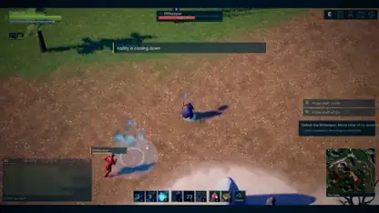</a> 
<strong>A PvP arena game in Unreal Engine</strong> 
<a href="../../prompts/parallelao-877365.md">View details · GitHub</a> · <a href="../../media/parallelao-877365/video.6ff4d022cc.mp4">Watch video ↗</a> · <a href="https://x.com/parallelao/status/2119889035149877365">@parallelao · Original post ↗</a> 
Games &amp; Interactive Experiences · Prompt not published · 2026-11-09
</td>
</tr>
<tr>
<td width="33%" valign="top">
<a href="../../media/crtvteknologist-200528/video.a68613dbba.mp4">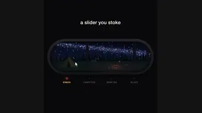</a> 
<strong>A slider you stoke like a campfire</strong> 
<a href="../../prompts/crtvteknologist-200528.md">View details · GitHub</a> · <a href="../../media/crtvteknologist-200528/video.a68613dbba.mp4">Watch video ↗</a> · <a href="https://x.com/crtvTeknologist/status/2119888532886200528">@crtvTeknologist · Original post ↗</a> 
Games &amp; Interactive Experiences · Prompt not published · 2026-11-09
</td>
<td width="33%" valign="top">
<a href="../../media/seanaiux-505512/video.2f6a49fd35.mp4">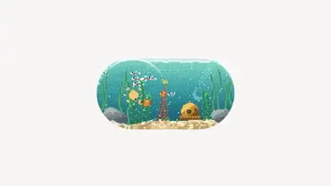</a> 
<strong>A pixel-art toggle switch</strong> 
<a href="../../prompts/seanaiux-505512.md">View details · GitHub</a> · <a href="../../media/seanaiux-505512/video.2f6a49fd35.mp4">Watch video ↗</a> · <a href="https://x.com/seanaiux/status/2119888254753505512">@seanaiux · Original post ↗</a> 
Games &amp; Interactive Experiences · Prompt not published · 2026-11-09
</td>
<td width="33%" valign="top">
<a href="../../media/bertranddiouly-765001/video.bf42882ce1.mp4">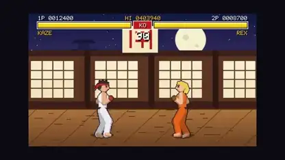</a> 
<strong>A Street Fighter 2 clone in 34 minutes</strong> 
<a href="../../prompts/bertranddiouly-765001.md">View details · GitHub</a> · <a href="../../media/bertranddiouly-765001/video.bf42882ce1.mp4">Watch video ↗</a> · <a href="https://x.com/BertrandDiouly/status/2119886197648765001">@BertrandDiouly · Original post ↗</a> 
Games &amp; Interactive Experiences · Prompt not published · 2026-11-09
</td>
</tr>
<tr>
<td width="33%" valign="top">
<a href="../../media/n1njacodex-001387/video.97987983c6.mp4">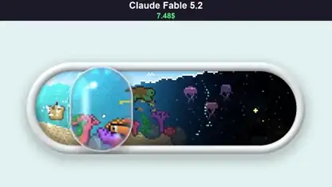</a> 
<strong>A volume slider with an underwater world</strong> 
<a href="../../prompts/n1njacodex-001387.md">View prompt · GitHub</a> · <a href="../../media/n1njacodex-001387/video.97987983c6.mp4">Watch video ↗</a> · <a href="https://x.com/N1njaCodex/status/2119883560937001387">@N1njaCodex · Original post ↗</a> 
Games &amp; Interactive Experiences · Public prompt · 2026-11-09
</td>
<td width="33%" valign="top">
 
<strong>A one-shot Souls-like boss fight</strong> 
<a href="../../prompts/onehitkilldev-709524.md">View details · GitHub</a> · <a href="../../media/onehitkilldev-709524/video.285ecbe021.mp4">Watch video ↗</a> · <a href="https://x.com/OneHitKillDev/status/2119882801222709524">@OneHitKillDev · Original post ↗</a> 
Games &amp; Interactive Experiences · Prompt not published · 2026-11-09
</td>
<td width="33%" valign="top">
<a href="../../media/samsonfraser-159458/video.aab5c4c9f4.mp4">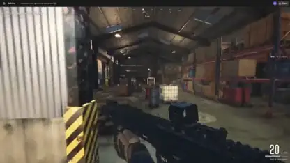</a> 
<strong>An end-to-end FPS playable in an artifact</strong> 
<a href="../../prompts/samsonfraser-159458.md">View details · GitHub</a> · <a href="../../media/samsonfraser-159458/video.aab5c4c9f4.mp4">Watch video ↗</a> · <a href="https://x.com/samsonfraser_/status/2119880736044159458">@samsonfraser_ · Original post ↗</a> 
Games &amp; Interactive Experiences · Prompt not published · 2026-11-09
</td>
</tr>
<tr>
<td width="33%" valign="top">
<a href="../../media/nikodemszymansk-435022/video.64f862e3df.mp4">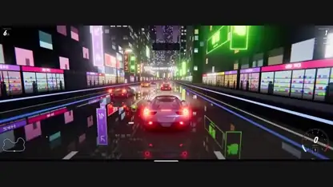</a> 
<strong>A night race through neon Tokyo</strong> 
<a href="../../prompts/nikodemszymansk-435022.md">View details · GitHub</a> · <a href="../../media/nikodemszymansk-435022/video.64f862e3df.mp4">Watch video ↗</a> · <a href="https://x.com/nikodemszymansk/status/2119880518875435022">@nikodemszymansk · Original post ↗</a> 
Games &amp; Interactive Experiences · Prompt not published · 2026-11-09
</td>
<td width="33%" valign="top">
 
<strong>Mirror Earth, the whole planet as a game</strong> 
<a href="../../prompts/mattshumer-036047.md">View details · GitHub</a> · <a href="../../media/mattshumer-036047/video.ec3b3e21ef.mp4">Watch video ↗</a> · <a href="https://x.com/mattshumer_/status/2119877065701036047">@mattshumer_ · Original post ↗</a> 
Games &amp; Interactive Experiences · Prompt not published · 2026-11-09
</td>
<td width="33%" valign="top">
<a href="../../media/vib3coded-505627/video.fc8fa57494.mp4">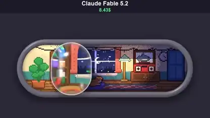</a> 
<strong>A volume slider with a cozy room inside</strong> 
<a href="../../prompts/vib3coded-505627.md">View prompt · GitHub</a> · <a href="../../media/vib3coded-505627/video.fc8fa57494.mp4">Watch video ↗</a> · <a href="https://x.com/vib3coded/status/2119876781700505627">@vib3coded · Original post ↗</a> 
Games &amp; Interactive Experiences · Public prompt · 2026-11-09
</td>
</tr>
<tr>
<td width="33%" valign="top">
<a href="../../media/emollick-540554/video.2fbff5b804.mp4">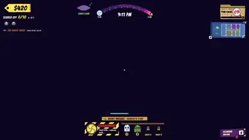</a> 
<strong>A reverse Scooby-Doo game where you do the scaring</strong> 
<a href="../../prompts/emollick-540554.md">View details · GitHub</a> · <a href="../../media/emollick-540554/video.2fbff5b804.mp4">Watch video ↗</a> · <a href="https://x.com/emollick/status/2119876449494540554">@emollick · Original post ↗</a> 
Games &amp; Interactive Experiences · Prompt not published · 2026-11-09
</td>
<td width="33%" valign="top">
<a href="../../media/mattshumer-810226/video.9bfc5c0785.mp4">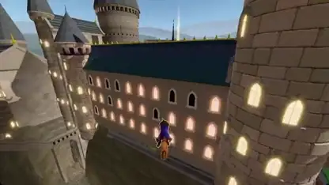</a> 
<strong>Harry Potter meets Fortnite</strong> 
<a href="../../prompts/mattshumer-810226.md">View prompt · GitHub</a> · <a href="../../media/mattshumer-810226/video.9bfc5c0785.mp4">Watch video ↗</a> · <a href="https://x.com/mattshumer_/status/2119872098306810226">@mattshumer_ · Original post ↗</a> 
Games &amp; Interactive Experiences · Public prompt · 2026-11-09
</td>
<td width="33%" valign="top">
<a href="../../media/kevin-t-ngo-695818/video.85d03a777b.mp4">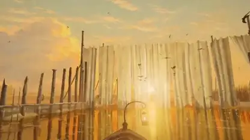</a> 
<strong>A boat ride through eight dreamlike worlds</strong> 
<a href="../../prompts/kevin-t-ngo-695818.md">View details · GitHub</a> · <a href="../../media/kevin-t-ngo-695818/video.85d03a777b.mp4">Watch video ↗</a> · <a href="https://x.com/kevin_t_ngo/status/2119868968307695818">@kevin_t_ngo · Original post ↗</a> 
Games &amp; Interactive Experiences · Prompt not published · 2026-11-09
</td>
</tr>
<tr>
<td width="33%" valign="top">
<a href="../../media/matthewberman-789992/video.d350634da7.mp4">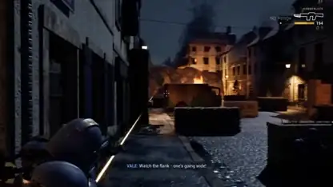</a> 
<strong>A Gears of War-style shooter in Unreal</strong> 
<a href="../../prompts/matthewberman-789992.md">View details · GitHub</a> · <a href="../../media/matthewberman-789992/video.d350634da7.mp4">Watch video ↗</a> · <a href="https://x.com/MatthewBerman/status/2119868629491789992">@MatthewBerman · Original post ↗</a> 
Games &amp; Interactive Experiences · Prompt not published · 2026-11-09
</td>
<td width="33%" valign="top">
<a href="../../media/matthewberman-254665/video.a42d638b13.mp4">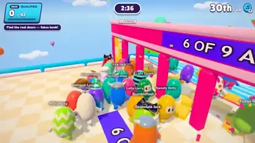</a> 
<strong>A complete Fall Guys-style party game</strong> 
<a href="../../prompts/matthewberman-254665.md">View details · GitHub</a> · <a href="../../media/matthewberman-254665/video.a42d638b13.mp4">Watch video ↗</a> · <a href="https://x.com/MatthewBerman/status/2119868630989254665">@MatthewBerman · Original post ↗</a> 
Games &amp; Interactive Experiences · Prompt not published · 2026-11-09
</td>
</tr>
</table>
