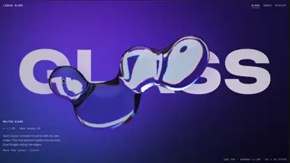

# Glass, amber and liquid metal type

A Fable 5.2 video by [@ioTanjiro](https://x.com/ioTanjiro).

[▶ Watch the video](../media/iotanjiro-606534/video.1176805203.mp4) · [Original post](https://x.com/ioTanjiro/status/2119891527438606534) · [On Skillry](https://skillry.dev/ai-videos/fable5-2/iotanjiro-606534?utm_source=github&utm_medium=readme&utm_campaign=awesome-fable5-2-videos)

- **Category:** 3D scenes
- **Length:** 0:25 (1908×1080)
- **Posted:** 2026-11-09

## From the post

> Playing with Fable 5.2
>
> What else should I try ?

_The author did not publish the exact prompt; the post above is what they shared._

**Tags:** Fable 5.2 · 3D Worlds & Simulations · Prompt not published
